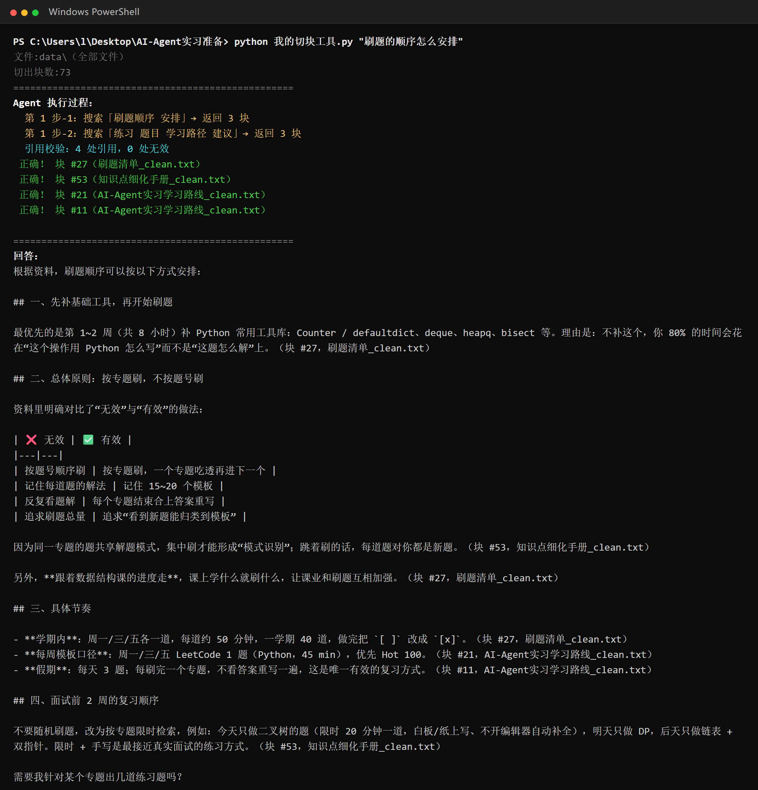
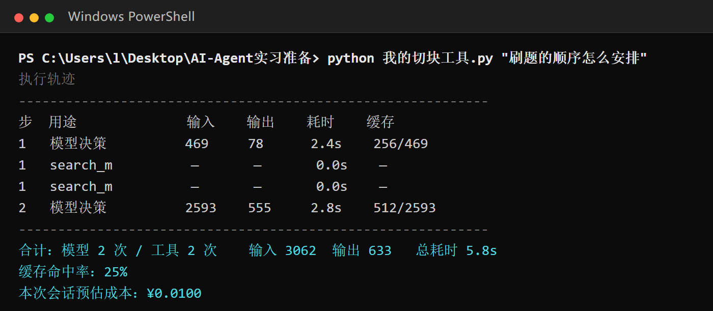
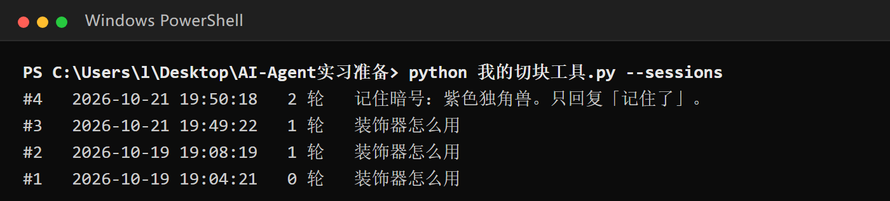

# 课程资料理解助手（RAG + Agent）

把课件/教材喂进去，用自然语言提问。Agent **自己决定搜什么、搜几次、要不要出题**，
基于检索到的原文回答，并在每句话后标出出处（块号 + 文件名）；资料里没有就拒答。

不是"调一次模型接口"，是**手写的工具调用循环**——模型只负责决策，执行、校验、纠错都在我的代码里。

### 效果

**一次真实问答**（命令行真实输出，未做任何修饰）



日志里两个查询词都是模型自己想的（用户只说了"刷题的顺序怎么安排"），
它自主换了措辞再搜了一次——这是 Agent 和"检索一次然后拼 prompt"的本质区别。
回答里的 4 条引用横跨三个文件，**全部通过引用校验**。

**调用链追踪**：每一步的 token、耗时、缓存命中率、预估成本



第 2 步的输入到了 2593 token（第 1 步只有 469），因为 `messages` 每轮累积、每次都要重发全部历史——
这是 Agent 比单轮问答贵的地方，也是"提高缓存命中率"成为优化重点的原因。

**会话持久化**：`--sessions` 列出历史对话，`-c` 接着最近一次聊，`-s N` 指定某一个



---

## 分层架构

```
第 4 层  应用      网页界面 / 多轮对话 / 会话管理          ✅ 全功能完成（app.py + templates/）
第 3 层  Agent     工具调用循环、多步决策、失败自愈          ✅ agent()
第 2 层  生成      检索结果 + prompt → 带引用的回答          ✅ agent() / do_generate_quiz()
第 1 层  检索      BM25 中文检索 + 停用词过滤                ✅ tokenize() / build_index() / search()
第 0 层  数据      多文件读取、标点感知切分                  ✅ read_file() / split_every() / load_all()
```

### 第 0 层 · 数据

| 函数 | 职责 |
|---|---|
| `read_file(path)` | 读文件；UTF-8 失败回退 GB18030，读不了时返回空串并提示 |
| `split_every(s, n)` | 按 `n` 切块，**但优先在 `。！？\n` 处断开**；实在找不到边界时最多多切 100 字 |
| `load_all(folder, n)` | 扫描目录下全部 `.txt`/`.md`，切块后合并；主程序传 `BASE/data` |

### 第 1 层 · 检索

- `tokenize(text)`：`jieba.lcut`（先转小写）+ 停用词过滤（词表 239 行、去重后 237 个；代码另叠加 6 个疑问词，运行时 243 条）
- `build_index(chunks)`：`BM25Okapi`
- `search(query, chunks, bm25, topk=3)`：BM25 取正分前 3 块；全无正分时按查询词与块的字面重合度兜底。**块头自带块号和文件名**（这是后面引用能溯源的前提）

### 第 2、3 层 · Agent

`agent(question, chunks, bm25, trace, max_steps=5, history=None)` 手写的循环（`bm25` 由外部传入复用，`history` 用于续聊）：

```
while 步数 < 5:
    resp = 模型(messages, tools=TOOLS)        # 带指数退避重试 3 次
    记录 trace
    if 模型没有调用工具:                       # 它认为可以直接回答
        引用校验 → 不通过就回灌错误让它重答（只给 1 次机会）
        return 回答
    for 每个 tool_call:
        白名单检查 → 参数解析 → 空值检查        # 四道防线的前三道
        执行工具，把结果作为 role="tool" 追加回 messages
```

两个工具：

| 工具 | 参数 | 做什么 |
|---|---|---|
| `search_material` | `query` | 检索资料 |
| `generate_quiz` | `topic`, `count`(1~10) | 先检索该知识点，再让模型只依据检索结果出题 |

### 第 4 层 · 可观测性

每次模型调用都记一条 `trace`：步数 / 用途 / 输入 token / 输出 token / **缓存命中 token** / 耗时。
结束时打印表格 + 命中率 + 按官方定价估算的成本：

```
执行轨迹
------------------------------------------------------------
步  用途              输入    输出    耗时    缓存
1   模型决策          468     50      1.6s    256/468
1   search_m          —       —       0.0s    —
2   模型决策          1573    338     2.0s    1408/1573
------------------------------------------------------------
合计：模型 2 次 / 工具 1 次    输入 2041  输出 388   总耗时 4.0s
缓存命中率：82%
本次会话预估成本：¥0.0066
```

> 表格对齐踩过一个坑：`len("模型决策") == 4`，但它在终端里占 **8 列**。
> 所以所有列宽必须用 `dwidth()`（按 `unicodedata.east_asian_width` 数显示宽度）而不能用 `len()` 或 `f"{:<18}"`。

---

## 快速开始

```powershell
# 1. 装依赖（只有 3 个第三方库，版本见 requirements.txt）
python -m pip install -r requirements.txt

# 2. 配 Key（Windows 用户级环境变量，需新开终端才生效）
setx DEEPSEEK_API_KEY "sk-xxxxxxxx"

# 3. 把 .txt / .md 课件放进 data/ 目录，然后提问
python rag.py "装饰器怎么用"
```

命令行参数是"智能"的（`main()` 里按顺序判断）：

| 命令 | 含义 |
|---|---|
| `python rag.py` | 读 `data/`，块大小 500，只演示分词和切块效果 |
| `python rag.py "装饰器怎么用"` | 读 `data/`，提问 |
| `python rag.py 300 "装饰器怎么用"` | 块大小改成 300 |
| `python rag.py 某文件.txt "装饰器"` | 只查单个文件 |

---

## 关键设计决策（都是实测出来的，不是拍脑袋）

这一节是我认为项目里最值得讲的部分：**三个方案被我自己的测量否掉了**。

### 决策 1：术语表 → 不加（实测零收益）

中文检索的经典问题是"双指针"会被切成 `['双','指针']`，只有"指针"有区分度。
我手工整理了 35 个术语加进 jieba 词典，然后测严格 top-1 准确率：

| 方案 | 严格 top-1 |
|---|---|
| 不带术语表 | **6 / 6** |
| 带术语表 | **6 / 6** |

**零收益。** 原因：BM25 的 IDF 项**已经编码了"稀有词更重要"**这个直觉，
再手工叠一层权重属于重复计数，反而可能淹没真正有区分度的词。
→ 所以**默认不加，术语表保留为可选**。

（另一个更隐蔽的坑：`jieba.load_userdict` 必须在**任何** `cut` 之前调用，
否则词典静默不生效——我一度以为"加了词典反而全变 0 分"，其实是索引用的旧分词、查询用的新分词，两边不一致。）

### 决策 2：向量检索 → 不替换 BM25，以后做融合

BM25 强在精确术语匹配（查"装饰器"能准确定位），向量强在语义近义（查"怎么复用代码"也能找到装饰器那段）。
**它们不是替代关系。** 当前先把 BM25 做到可测量、当作基线，以后加向量做混合检索。

### 决策 3：引用校验只做两级 → 第三级被我证伪

三层设计：L1 块号是否存在 / L2 本次是否真的检索过 / L3 引用内容是否与原文一致。

- **L1、L2 实测 5 个查询 0 违规**（模型是"看着检索结果挑的"，它甚至会主动放掉检索到但不相关的块）
- **L3 我做了原型，然后自己砍掉了**：用"引用标记前的字符重合度"检测，结果全部只有 **4%~9%**，看起来像瞎引——但实际全是误报。因为那段文字是**模型自己的过渡句**（如"资料明确给出了对比（"），真正的原文引用在标记之后；而且模型是**改写式引用**（`同一专题的题共享解题模式` → `同类题共享解题模式`），字符级比对必然全不匹配。

→ **结论：只保证"出处真实"，不保证"内容真实"**，并在面试里主动说明这个边界。

### 决策 4：切分要感知标点

朴素按长度硬切会把词切成两半。改成"优先在句末标点处断开"后：

| 块大小 | 朴素硬切 | 标点感知 |
|---|---|---|
| n = 500 | 41.1%（30/73 个边界） | **0.0%** |
| n = 300 | 35.0%（43/123 个边界） | **0.9%** |

> 口径：块边界落在 jieba 多字词内部的比例，`eval/chunk_eval.py` 可复现。早期小数据版本记的是 32% / 4%，当前按仓库自带资料重跑为以上数字。

一个块被切得越碎，检索返回的上下文越难读，模型越容易答偏。

---

## 四道防线

模型输出和用户输入都当**不可信**处理，校验失败**回灌错误文本**而不是抛异常：

| # | 防的是 | 做法 |
|---|---|---|
| 1 | 模型调用不存在的工具 | `ALLOWED_TOOLS` 白名单，拒绝时**把可用工具名列给模型** |
| 2 | 工具参数不是合法 JSON / 不是对象 | `json.loads` 包 `try/except (JSONDecodeError, TypeError)` → 只接受 dict，其余退回空字典 |
| 3 | 参数缺字段 / 为空 / 类型不对 | 非字符串或空 `query`、`topic` 直接拒绝；`count` 排除 bool |
| 4 | 编造引用出处 | 引用校验（L1 + L2 两级），失败时把**本次真实检索过的块号列表**回灌 |

**第 1 条和第 4 条的关键都是"把白名单告诉模型"**——只说"你错了"它改不对，
说"可用工具只有这几个"它立刻就能自我修正。

---

## 实测数据

| 指标 | 实测值 |
|---|---|
| 知识库规模 | 3 个文件 → **73 块**（n=500） |
| 纯检索耗时 | **0.0 s**（20 次检索共 0.001 s） |
| 单次问答总耗时 | 3~6 s |
| 单次问答成本 | **¥0.007 ~ ¥0.013** |
| 缓存命中率 | **22% ~ 82%**（同一份代码，随调用历史变化） |
| 输入 token 增长 | 第 1 轮 461 → 第 2 轮 **1856**（阶梯式） |
| 引用违规数 | **0 / 5 个查询** |

其中"输入 token 阶梯式增长"是通过 tracing 发现的：因为 `messages` 会累积，
**每一轮都要把全部历史重新发一遍**——这是 Agent 比单轮问答贵的根本原因，
也是优化的方向（固定 system 前缀、保持会话连续以提高缓存命中率）。

> 说明：以上为小样本实测（多数指标 n=5~6 次查询或单次运行），未做统计显著性验证，仅作方向性参考。
> 切块、检索、引用兜底这三块可用 `eval/` 下脚本离线复现；延迟、费用、缓存命中率需要真实 API Key 与调用历史。

---

## 已知限制

- **会话持久化已实现**：SQLite 存 `会话.db`，`--sessions` 列表、`-c` 续最近、`-s N` 指定会话
- **Web全链路已跑通**：根目录 `app.py` 的 `/ask` 返回JSON，`/` 和 `/ask-page` 是浏览器表单页，已支持多轮对话、历史会话列表、会话删除全功能，适配线程池跨线程调用；还没有公网部署
- **检索只有 BM25**：语义近义查询（"怎么复用代码"）召不回来
- **引用校验不查内容**：只能保证出处真实（理由见决策 3）
- **同名文件问题已修复**：`load_all` 改用 `str(f.relative_to(folder))`，不同目录的同名文件能区分

---

## 技术栈

| 用途 | 选择 |
|---|---|
| 中文分词 | `jieba` 0.42.1 |
| 检索 | `rank_bm25` 0.2.2（BM25Okapi） |
| 模型调用 | `openai` 2.52.0，`base_url` 指向 DeepSeek（OpenAI 兼容协议） |
| 模型 | `deepseek-chat` |
| 其余 | 全部标准库（`sys` / `os` / `json` / `time` / `re` / `pathlib` / `unicodedata` / `sqlite3`） |

**820 行单文件（引擎 + 命令行入口），3 个第三方依赖（+ 标准库 sqlite3）。**

---

## 文件说明

```
rag.py               引擎 + 命令行入口（检索 / Agent / DB / CLI）
app.py               Web 入口（FastAPI 路由）
templates/           网页模板（index.html）
停用词表.txt         239 行停用词（71 符号 + 72 单字虚词 + 96 多字虚词；含 2 个重复，去重 237 个）
术语表.txt           35 个术语（可选，实测零收益，默认不启用）
eval/                离线评估脚本（chunk_eval / retrieval_eval / citation_gate）
data/                知识库
  AI-Agent实习学习路线_clean.txt
  刷题清单_clean.txt
  知识点细化手册_clean.txt
踩坑记录.md          开发过程中的真实错误与定位过程
```
