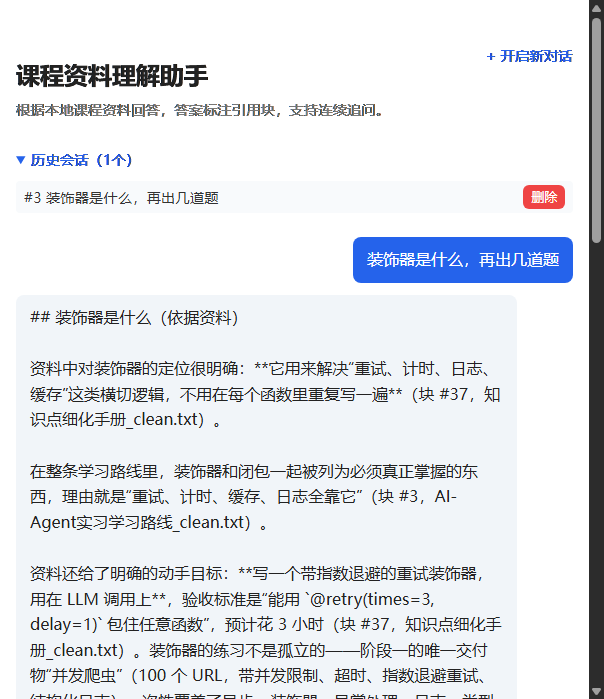
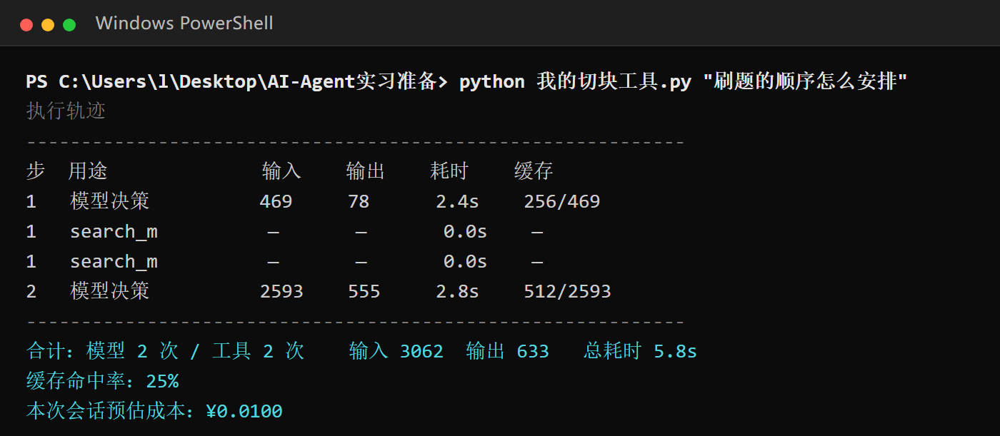

# 文档知识库问答 Agent（RAG + Function Calling）

一个**本地文档问答 Agent**：把课件/教材喂进去，用自然语言提问，Agent 基于资料回答并标注出处，资料里没有就拒答。

不是「调一次模型接口」，而是**手写的 Function Calling 循环**——模型只负责决策，检索、执行、校验、纠错都在代码里完成。

## 核心特性

- **手写 Function Calling 循环**：不依赖 LangChain，模型自主决定何时检索、检索什么、要不要出题，支持多工具调用与最多 5 步推理
- **BM25 中文检索**：jieba 分词 + 239 词停用词表 + 标点感知切分，精确匹配技术术语
- **两级引用校验**：校验引用块号「是否存在」+「本次是否真实检索过」，失败时回灌真实块号让模型自我修正，实测 5 个查询 0 违规
- **多轮对话持久化**：SQLite 存储会话，网页端支持续聊、历史会话管理、删除
- **可观测性**：逐步记录 token、耗时、缓存命中率、预估成本，命令行和网页端都能看到执行轨迹
- **Web 全功能**：FastAPI + 传统表单（零前端框架），网页问答 + JSON 接口 + 多轮对话

## 效果展示

**网页问答界面**：多轮对话、引用标注、历史会话管理与删除



**执行轨迹**：逐步展示 token、耗时、缓存命中率与成本



## 架构

四层流水线，顺序固定：

```
第 4 层  应用      网页界面 / 多轮对话 / 会话管理
第 3 层  Agent     工具调用循环、多步决策、失败自愈
第 2 层  生成      检索结果 + prompt → 带引用的回答
第 1 层  检索      BM25 中文检索 + 停用词过滤
第 0 层  数据      多文件读取、标点感知切分
```

## 快速开始

### 环境要求

- Python 3.10+
- DeepSeek API Key（OpenAI 兼容协议）

### 安装

```bash
pip install jieba rank-bm25 openai
# Web 版额外需要
pip install fastapi uvicorn jinja2 python-multipart
```

### 配置 API Key

```bash
# Windows（用户级环境变量，需新开终端生效）
setx DEEPSEEK_API_KEY "sk-xxxxxxxx"

# Linux / macOS
export DEEPSEEK_API_KEY="sk-xxxxxxxx"
```

### 命令行提问

```bash
# 把 .txt 资料放进 data/ 目录，然后提问
python cli.py "装饰器怎么用"

# 指定块大小
python cli.py 300 "装饰器怎么用"

# 只查单个文件
python cli.py 某文件.txt "装饰器"
```

### 启动 Web 服务

```bash
cd 05-RAG-Agent项目
python -m uvicorn app:app --reload
```

浏览器打开 `http://127.0.0.1:8000`，支持多轮对话、历史会话、执行详情。

## 核心设计决策（都是实测出来的，不是拍脑袋）

1. **术语表 → 不加（实测零收益）**：手工整理 35 个术语加入 jieba 词典，严格 top-1 准确率 6/6 vs 6/6，零收益。根因是 BM25 的 IDF 已经编码了「稀有词更重要」，叠加权重属重复计数。默认禁用，保留为可选。

2. **向量检索 → 不替换 BM25，以后做融合**：BM25 强在精确术语匹配，向量强在语义近义，两者不是替代关系。当前把 BM25 做到可测量当作基线，后续加向量做混合检索。

3. **引用校验只做两级 → 第三级被证伪**：做过「引用内容一致性」校验原型，字符重合度仅 4%~9% 且全为误报（模型是改写式引用），主动砍掉。结论是「只保证出处真实，不保证内容真实」。

4. **切分感知标点**：朴素硬切有 32% 的块切断词，改成优先在句末标点断开后降到 4%（n=500）。

## 目录结构

```
cli.py           命令行版主程序（759 行）
data/                     知识库目录
停用词表.txt              239 个停用词
术语表.txt                35 个术语（可选，实测零收益）
05-RAG-Agent项目/         Web 版（FastAPI）
  app.py                  服务入口 + 路由
  rag.py                  检索 / Agent 层
  templates/index.html    网页模板
  requirements.txt        运行依赖
docs/                     项目文档与截图
```

## 技术栈

| 用途 | 选择 |
|---|---|
| 中文分词 | jieba |
| 检索 | rank-bm25（BM25Okapi） |
| 模型调用 | openai SDK + DeepSeek（OpenAI 兼容） |
| Web | FastAPI + Jinja2 |
| 存储 | SQLite |

## 已知限制与后续规划

- 检索只有 BM25，语义近义查询召回不足 → 规划混合检索
- 仅本机运行，未做公网部署、鉴权、限流 → 规划生产级升级
- 引用校验保证出处真实，不保证内容与原文逐字一致
